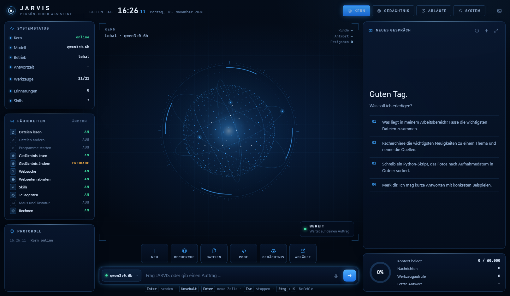

<p align="center">
  
</p>

<h1 align="center">JARVIS</h1>

<p align="center">
  <strong>Ein persönlicher KI-Assistent für den Desktop, der Aufgaben erledigt statt nur darüber zu reden.</strong><br>
  Lokal mit Ollama oder mit OpenAI, Anthropic, Gemini und OpenRouter. Ohne Konto, ohne Server, ohne Telemetrie.
</p>

<p align="center">
  
  
  
  
</p>

<p align="center">
  
</p>

JARVIS recherchiert im Web, liest und ändert Dateien, schreibt Code und führt ihn aus, merkt sich, was du ihm erzählst, und arbeitet wiederkehrende Aufträge ab. Das Sprachmodell wählst du selbst. Es läuft entweder kostenlos auf deinem Rechner oder über den API-Key eines Cloud-Anbieters. JARVIS selbst läuft immer bei dir. Jede Installation ist eigenständig und schickt nichts an den Entwickler.

## Inhalt

- [Highlights](#highlights)
- [Systemvoraussetzungen](#systemvoraussetzungen)
- [Installation](#installation)
- [Der erste Start](#der-erste-start)
- [Funktionen](#funktionen)
- [Bedienung](#bedienung)
- [Sicherheit und Datenschutz](#sicherheit-und-datenschutz)
- [Kommandozeile](#kommandozeile)
- [Fehlerbehebung](#fehlerbehebung)
- [Projektstand](#projektstand)
- [Entwicklung](#entwicklung)
- [Lizenz](#lizenz)

## Highlights

- **Lokal und privat.** Mit Ollama verlässt keine einzige Nachricht den Rechner. Der Einrichtungsassistent erkennt Ollama, schlägt ein passendes Modell vor und lädt es herunter.
- **Sechs Anbieter, eine Oberfläche.** Ollama, OpenAI, Anthropic, Google Gemini, OpenRouter und jeder OpenAI-kompatible Dienst, jeweils mit Streaming. Zwischen den Modellen wechselst du mit Strg+K.
- **Werkzeuge statt Textbausteine.** Dateien, Code, Websuche, Gedächtnis, Teilagenten, wiederkehrende Abläufe und optional Sprache sowie Maus und Tastatur.
- **Du behältst die Kontrolle.** Jede Fähigkeit lässt sich einzeln abschalten. Wenn JARVIS etwas verändern will, fragt er vorher nach und zeigt dir genau, was passieren soll, bei Dateien als Diff.
- **Sauber installiert.** Keine Adminrechte, keine Registry-Einträge, keine Änderung am PATH. Die Deinstallation entfernt alles bis auf deine Daten.
- **Schlank.** Die einzige Pflichtabhängigkeit ist `httpx`. Die Oberfläche ist reines HTML, CSS und JavaScript ohne Build-Schritt.

## Systemvoraussetzungen

| | Mindestens | Empfohlen |
|---|---|---|
| Betriebssystem | Windows 10, macOS oder Linux | Windows 11 |
| Python | 3.11 (unter Windows installiert der Installer es auf Wunsch) | 3.12 oder neuer |
| Browser für das App-Fenster | Edge, Chrome, Chromium oder Brave | Edge oder Chrome |
| Arbeitsspeicher für lokale Modelle | 8 GB | 16 GB oder mehr, dazu eine Grafikkarte |
| Lokale Modelle | [Ollama](https://ollama.com/download) | |

Ohne Ollama funktioniert JARVIS mit einem Cloud-Anbieter. Du brauchst dann einen API-Key.

## Installation

### Windows

1. Lade das Projekt herunter: auf GitHub über **Code → Download ZIP** oder unter **Releases**. Entpacke die ZIP-Datei.
2. Doppelklick auf `install.cmd`.

Das Skript sucht Python 3.11 oder neuer und bietet an, es über `winget` zu installieren, falls es fehlt. Dann legt es eine eigene Programmumgebung unter `%LOCALAPPDATA%\JARVIS\app` an und erstellt Verknüpfungen im Startmenü und auf dem Desktop. Administratorrechte braucht es nicht.

Als Fenster nutzt JARVIS einen Chromium-Browser im App-Modus, also ohne Adressleiste und Tabs. Der Browser muss nicht dein Standardbrowser sein. JARVIS bekommt ein eigenes Browserprofil und berührt deine Lesezeichen und Anmeldungen nicht. Ist kein passender Browser installiert, öffnet sich JARVIS im Standardbrowser.

### macOS und Linux

```bash
./install.sh
```

Danach steht JARVIS im Anwendungsmenü (Linux) oder unter `~/Applications` (macOS).

### Optionale Erweiterungen

| Extra | Was es bringt |
|---|---|
| `voice` | Spracheingabe komplett offline (Vosk) und Vorlesen mit der Systemstimme |
| `computer` | Maus, Tastatur und Bildschirmfotos |

```powershell
.\install.cmd -Extras voice,computer
```

Unter macOS und Linux: `./install.sh --extras voice,computer`.

### Aktualisieren

Neue Version herunterladen und den Installer noch einmal starten. Gespräche, Gedächtnis und Einstellungen bleiben erhalten.

### Deinstallieren

```powershell
.\install.ps1 -Uninstall
```

Unter macOS und Linux: `./install.sh --uninstall`. Programm, Verknüpfungen und das Browserprofil werden entfernt. Deine Daten bleiben absichtlich liegen. Wer auch sie loswerden will, löscht den Datenordner (siehe [Wo die Daten liegen](#wo-die-daten-liegen)).

## Der erste Start

Beim ersten Start führt dich ein Assistent in vier Schritten durch die Einrichtung.

**1. Modell wählen.** Lokal mit Ollama ist privat und kostenlos. Ist Ollama installiert, erkennt JARVIS das, zeigt die vorhandenen Modelle und schlägt ein neues passend zum Arbeitsspeicher vor:

| Modell | Download | Geeignet für |
|---|---|---|
| `qwen3:1.7b` | ca. 1,4 GB | ältere Rechner und Laptops |
| `qwen3:4b` | ca. 2,5 GB | Rechner ab 8 GB |
| `qwen3:8b` | ca. 5,2 GB | Rechner ab 16 GB |
| `qwen3:14b` | ca. 9,3 GB | Rechner ab 32 GB oder mit guter Grafikkarte |

Läuft Ollama nicht, startet JARVIS es auf Knopfdruck. Mit einem Cloud-Anbieter sind die Antworten meist besser und schneller. Dafür brauchst du einen API-Key und zahlst nach Nutzung. JARVIS prüft den Key und lädt die verfügbaren Modelle.

**2. Freigaben festlegen.** Drei Voreinstellungen stehen zur Wahl:

| Voreinstellung | Was JARVIS darf |
|---|---|
| Vorsichtig | Gespräch, Gedächtnis lesen und Rechnen. Kein Zugriff auf Dateien oder das Web. |
| Assistent (empfohlen) | Dateien im Arbeitsordner lesen, im Web suchen, sich Dinge merken, Teilagenten beauftragen |
| Volle Kontrolle | Alles, auch Dateien ändern, Programme starten und Maus und Tastatur. Jede dieser Aktionen fragt trotzdem einzeln nach. |

Alles lässt sich später unter **System → Berechtigungen** fein einstellen.

## Funktionen

| Bereich | Was geht |
|---|---|
| Gespräch | Antworten erscheinen live, Esc bricht ab. Werkzeugschritte sind sichtbar, der Verlauf ist durchsuchbar, Gespräche lassen sich umbenennen und löschen. |
| Dateien und Code | Dateien auflisten, lesen, durchsuchen, gezielt ändern, verschieben und in einen Papierkorb löschen. Programme starten, etwa Tests oder Build-Skripte. |
| Web | Websuche über Brave Search oder eine eigene SearXNG-Instanz. Seiten abrufen und lesen. |
| Gedächtnis | Fakten über dich und deine Arbeit. Passende Einträge bekommt das Modell automatisch mit. Export als JSON. |
| Abläufe | Aufträge, die JARVIS regelmäßig erledigt, zum Beispiel jeden Morgen einen Ordner zusammenfassen. |
| Teilagenten | Rollen für Recherche, Entwicklung, Review, Planung und Analyse, die parallel arbeiten. |
| Computer | Programme und Dokumente öffnen, Fenster in den Vordergrund holen. Mit dem Extra `computer` auch Maus, Tastatur und Bildschirmfotos. |
| Sprache | Mit dem Extra `voice` Spracheingabe offline und Vorlesen. |
| Erweiterungen | Skills im `SKILL.md`-Format, kompatibel zu Claude, und Python-Plugins. Drei Skills sind dabei: `code-review`, `research-brief` und `safe-refactor`. Mehr in [docs/skills.md](docs/skills.md). |

## Bedienung

| Taste | Wirkung |
|---|---|
| Enter | senden |
| Umschalt+Enter | neue Zeile |
| Esc | laufende Antwort stoppen, Dialog schließen |
| Strg+K | Befehlspalette: Modell wechseln, Gespräch suchen, Bereich öffnen |
| Alt+N | neues Gespräch |
| Alt+H | Verlauf ein- und ausblenden |

## Sicherheit und Datenschutz

- **Fähigkeiten statt Blankoscheck.** Jedes Werkzeug gehört zu einer Fähigkeit, die du ein- oder ausschaltest. Ausgeschaltete Werkzeuge bekommt das Modell gar nicht zu sehen.
- **Freigabe vor jeder Änderung.** Dateien ändern, Programme starten, das Gedächtnis ändern sowie Maus und Tastatur steuern fragt vor jeder einzelnen Aktion nach. Der Dialog zeigt bei Dateien einen Diff, bei Programmen den vollständigen Befehl und den Pfad des Programms, das tatsächlich startet.
- **Nur lokal erreichbar.** Die Oberfläche spricht ausschließlich über `127.0.0.1` mit JARVIS. Das Fenster öffnet sich mit einem Schlüssel, der nur ein einziges Mal gilt. Andere Webseiten im Browser kommen nicht an JARVIS heran.
- **Keys verschlüsselt.** API-Keys liegen verschlüsselt im Benutzerkonto (Windows DPAPI, unter macOS und Linux im Schlüsselbund des Systems) und tauchen nie in Logs oder Fehlermeldungen auf.
- **Was beim Anbieter landet.** Mit einem Cloud-Profil gehen deine Nachrichten, passende Erinnerungen und Werkzeugergebnisse an den gewählten Anbieter. Mit Ollama verlässt nichts den Rechner.

Details stehen in [docs/security.md](docs/security.md).

### Wo die Daten liegen

| Was | Windows | macOS und Linux |
|---|---|---|
| Gespräche, Gedächtnis, Abläufe (`jarvis.sqlite3`) | `%LOCALAPPDATA%\JARVIS` | `~/.local/share/jarvis` |
| API-Keys (`secrets.json`, verschlüsselt) | `%LOCALAPPDATA%\JARVIS` | Schlüsselbund des Systems |
| Arbeitsordner, in dem JARVIS Dateien lesen und ändern darf | `%USERPROFILE%\JARVIS` | `~/JARVIS` |

Der Datenordner lässt sich mit der Umgebungsvariable `JARVIS_DATA_DIR` verlegen.

## Kommandozeile

Alles aus der Oberfläche geht auch im Terminal. Nach der Installation liegt das Programm unter `%LOCALAPPDATA%\JARVIS\app\Scripts\jarvis.exe` (Windows) bzw. `~/.local/share/jarvis/app/bin/jarvis`.

```text
jarvis chat                              Chat im Terminal
jarvis ask "Fasse README.md zusammen"    eine einzelne Frage
jarvis profiles add Lokal ollama qwen3:8b
jarvis profiles pull Lokal qwen3:8b      Ollama-Modell herunterladen
jarvis profiles think Lokal aus          ohne Nachdenken, deutlich schneller
jarvis permissions enable files.read
jarvis automations serve                 Abläufe ohne Fenster ausführen
jarvis gui --no-window                   nur den Server starten, URL ausgeben
jarvis export backup.json
```

`jarvis --help` zeigt alle Befehle.

## Fehlerbehebung

**Windows zeigt „Der Computer wurde durch Windows geschützt“.**
Das passiert bei Skripten aus dem Internet, die nicht signiert sind. Klicke auf **Weitere Informationen → Trotzdem ausführen**. Wer vorher prüfen will, was passiert: `install.cmd` startet nur `install.ps1`, und beide sind lesbarer Text.

**„Ollama ist installiert, läuft aber nicht.“**
JARVIS bietet in diesem Fall einen Knopf zum Starten an. Hilft das nicht, Ollama einmal von Hand starten oder neu installieren: [ollama.com/download](https://ollama.com/download).

**Lokale Antworten sind sehr langsam.**
Ein kleineres Modell wählen oder das Nachdenken ausschalten (`jarvis profiles think <Profil> aus`). Mit einer Grafikkarte, deren Speicher für das Modell reicht, antwortet JARVIS in wenigen Sekunden.

**Das Fenster öffnet sich als normaler Browser-Tab.**
Es wurde kein Edge, Chrome, Chromium oder Brave gefunden. JARVIS funktioniert trotzdem. Für das eigene App-Fenster einen dieser Browser installieren.

**„Bitte JARVIS über den Starter öffnen.“**
Die Adresse wurde direkt im Browser aufgerufen. JARVIS über das Startmenü, die Desktop-Verknüpfung oder `jarvis gui` starten.

## Projektstand

Version 0.3.0. Die Funktionen oben sind gebaut und durch automatische Tests geprüft, die auf Windows, Linux und macOS mit Python 3.11 bis 3.13 laufen. Von Hand geprüft wurde JARVIS unter Windows 11 mit Ollama, auch mit Grafikkarte. Noch nicht geprüft sind unter anderem der Installer unter macOS und Linux, Cloud-Anbieter mit echtem Key und die Sprachfunktionen. Die vollständige Liste und die nächsten Schritte stehen in [TASKS.md](TASKS.md), die Änderungen pro Version in [CHANGELOG.md](CHANGELOG.md).

## Entwicklung

```powershell
python -m venv .venv
.venv\Scripts\python -m pip install -e .
$env:PYTHONPATH = "src;tests"
.venv\Scripts\python -m unittest discover -s tests
```

Unter macOS und Linux: `source .venv/bin/activate` und `PYTHONPATH=src:tests`.

| Dokument | Inhalt |
|---|---|
| [ARCHITECTURE.md](ARCHITECTURE.md) | Wie alles zusammenhängt |
| [AGENTS.md](AGENTS.md) | Regeln für Beiträge, auch für Coding-Agenten |
| [docs/interfaces.md](docs/interfaces.md) | Schnittstellen für Werkzeuge, Plugins und Skills |
| [docs/providers.md](docs/providers.md) | Anbieter und ihre Eigenheiten |
| [docs/testing.md](docs/testing.md) | Tests und wie man sie schreibt |
| [docs/design.md](docs/design.md) | Gestaltung der Oberfläche |
| [docs/decisions.md](docs/decisions.md) | Getroffene Entscheidungen und warum |

Fehler und Ideen gerne als Issue. Pull Requests bitte mit Tests, wie in [AGENTS.md](AGENTS.md) beschrieben.

## Lizenz

[MIT](LICENSE). Du darfst JARVIS frei verwenden, verändern und weitergeben, auch kommerziell, solange der Lizenzhinweis erhalten bleibt.
